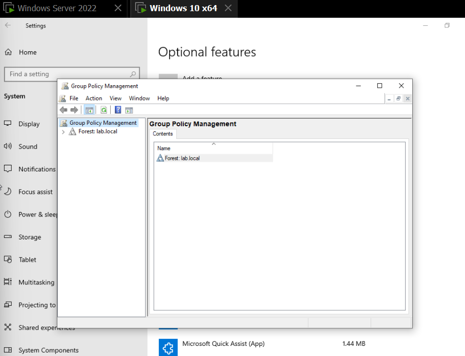

# AD-DC Lab: Active Directory Infrastructure dari Nol

Project ini saya bangun buat belajar Active Directory dan Group Policy Management secara hands-on, mulai dari instalasi Domain Controller sampai implementasi kebijakan keamanan dan file sharing yang biasa dipakai di perusahaan. Semua dikerjakan di lab virtual (VMware Workstation) di laptop pribadi, bukan environment production, tapi semua konsep dan command yang dipakai sama persis dengan yang dipakai di environment enterprise beneran.

Saya dokumentasikan bukan cuma "apa yang berhasil", tapi juga masalah yang saya temui di tengah jalan dan gimana cara saya menyelesaikannya, karena menurut saya itu yang lebih menunjukkan pemahaman dibanding sekadar screenshot command yang jalan mulus.

## Kenapa project ini

Saya belajar infrastruktur dari jalur yang agak tidak biasa, mulai dari VPS management dan network security, baru masuk ke Windows Server environment. Active Directory jadi fokus karena ini skill yang hampir selalu muncul di lowongan IT Infrastructure/System Administrator di Indonesia, terutama di perusahaan yang masih full Windows environment. Saya juga ingin project ini jadi bekal buat memahami infrastruktur serupa yang saya temui di tempat magang.

## Arsitektur Lab

```
                    ┌─────────────────────┐
                    │   DC01 (Server Core) │
                    │   Windows Server 2022 │
                    │   192.168.12.10        │
                    │   - AD DS              │
                    │   - DNS Server         │
                    │   - File Server        │
                    └──────────┬──────────┘
                               │
                         domain: lab.local
                               │
                    ┌──────────┴──────────┐
                    │      CLIENT01         │
                    │    Windows 10 Pro      │
                    │   192.168.12.129 (DHCP) │
                    └─────────────────────┘
```

**Kenapa Server Core, bukan Desktop Experience?**
Ini pilihan sadar, bukan default. Server Core punya attack surface lebih kecil dan jauh lebih ringan dari sisi resource, dan ini memang arah yang disarankan Microsoft untuk production environment sejak Windows Server 2012. Konsekuensinya, saya mengelola DC sepenuhnya lewat PowerShell dan remote tools (GPMC, RSAT) dari client, bukan klik-klik langsung di server. Ini juga lebih dekat ke cara kerja real di perusahaan yang serius soal security.

## Struktur Organisasi yang Dibangun

| OU | Group | User contoh |
|---|---|---|
| IT | IT-Staff | budi |
| Finance | Finance-Staff | siti, rina |
| HR | HR-Staff | andiw |

`rina` sengaja ditaruh di OU Finance tapi **tidak** dimasukkan ke group `Finance-Staff`, buat jadi kontrol pembanding waktu testing security filtering (OU vs group targeting itu dua hal yang sering tertukar pemahamannya).



## Apa yang Sudah Diimplementasikan

**1. Domain Controller & DNS**
Instalasi AD DS, promosi jadi Domain Controller, forest dan domain baru (`lab.local`), DNS Server terintegrasi.

**2. Struktur Organisasi**
Organizational Unit per divisi, user, dan security group, dibuat lewat PowerShell (bukan GUI), termasuk bulk-style provisioning.

**3. Domain Join & Otentikasi**
Client join ke domain, login pakai akun domain, validasi lewat `whoami` dan `gpresult`.

**4. Group Policy — Restriction & Password Policy**
- Blokir Control Panel untuk OU Finance
- Password & account lockout policy di level domain (complexity, history, lockout threshold)

**5. File Sharing & Permission**
- Shared folder per divisi dengan NTFS permission berbasis security group
- Drive mapping otomatis lewat GPO (tiap divisi dapat `Z:` dengan isi berbeda, sesuai akses masing-masing)
- Diuji dua arah: user yang berhak bisa akses, user yang tidak berhak ditolak (bukan cuma diasumsikan)


**6. Folder Redirection**
Documents dan Desktop user diarahkan ke server, supaya data tidak hilang kalau PC rusak dan tetap bisa diakses dari PC domain manapun.

**7. Printer Deployment**
Printer di-share dan didistribusikan otomatis lewat GPO, tanpa instalasi manual di tiap client.

**8. Security Filtering**
GPO ditarget ke security group tertentu (bukan seluruh isi OU), lengkap dengan permission Delegation yang sempat jadi sumber bug (lihat bagian masalah di bawah).

**9. Security Hardening**
- Fine-Grained Password Policy, kebijakan password lebih ketat khusus untuk `IT-Staff`
- Akun Guest dinonaktifkan
- Audit keanggotaan Domain Admins (least privilege)
- Review security audit log


**10. Maintenance & Disaster Recovery**
- `dcdiag` untuk cek kesehatan DC
- `repadmin` untuk cek status replikasi
- Backup System State sebagai simulasi disaster recovery dasar

## Masalah yang Saya Temui (dan Cara Menyelesaikannya)

Ini bagian yang menurut saya paling penting di dokumentasi ini.

**1. Client dan DC tidak bisa saling ping, padahal dua-duanya "NAT"**
DC saya kasih IP static di subnet `192.168.10.0/24`, padahal network NAT virtual yang sebenarnya jalan di VMware itu `192.168.12.0/24` (ketahuan dari gateway dan DHCP server client). Dua VM sama-sama pakai mode NAT bukan berarti otomatis satu subnet kalau salah satunya di-set manual ke range yang salah. Solusinya: samakan subnet IP static DC dengan subnet NAT yang sebenarnya dipakai VMware.

**2. Client tidak bisa join domain, opsi "Domain" di System Properties abu-abu**
Ternyata Windows yang terinstall itu edisi Home, dan Home tidak punya kemampuan join domain sama sekali, apapun status aktivasinya. Harus reinstall dengan edisi Pro.

**3. GPO security filtering sudah diset ke group tertentu, tapi malah tidak kena ke siapapun**
Ini jebakan yang cukup halus: begitu Authenticated Users dihapus dari Security Filtering, GPO juga kehilangan izin baca dari sisi komputer client, kecuali ditambahkan ulang permission Read lewat tab Delegation. Tanpa langkah ini, GPO terlihat benar di GPMC tapi tidak pernah diterapkan ke siapapun.

**4. Backup System State gagal dengan pesan lokasi backup tidak didukung**
`wbadmin` tidak mengizinkan backup target di drive yang sama dengan yang sedang dibackup. Solusinya menambah virtual disk kedua khusus sebagai target backup.

## Tools & Command yang Dipakai

PowerShell (`New-ADUser`, `New-ADGroup`, `New-ADOrganizationalUnit`, `Install-ADDSForest`, `Set-ADAccountPassword`, `New-ADFineGrainedPasswordPolicy`, `dcdiag`, `repadmin`, `wbadmin`), Group Policy Management Console, `icacls`, SMB file sharing.

## Yang Masih Jadi Rencana Lanjutan

- Automasi provisioning user/OU/group lewat satu script PowerShell dari CSV
- Multi-DC dengan replikasi, simulasi failover
- Implementasi LAPS
- Replikasi setup mail server (Zimbra) dengan integrasi LDAP ke AD ini, terinspirasi dari infrastruktur yang saya temui di tempat magang

## Catatan

Semua lab ini berjalan di environment virtual tertutup, bukan dipublikasikan ke internet. Password dan kredensial yang muncul di dokumentasi ini hanya berlaku di lab lokal dan sudah tidak relevan di luar environment ini.
