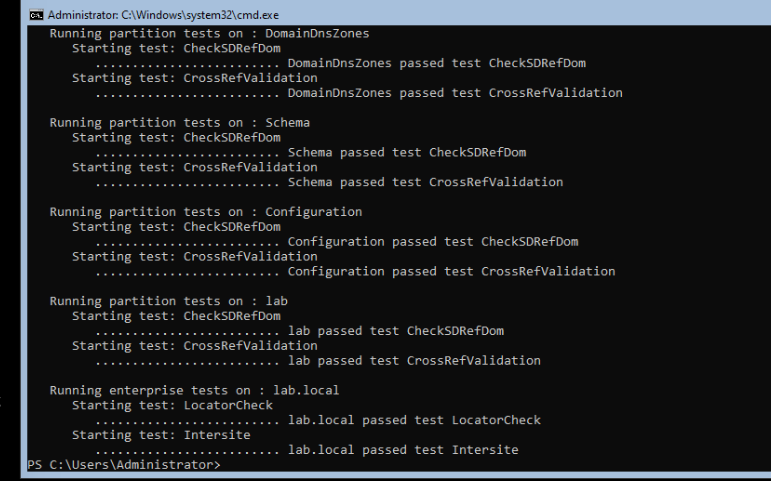
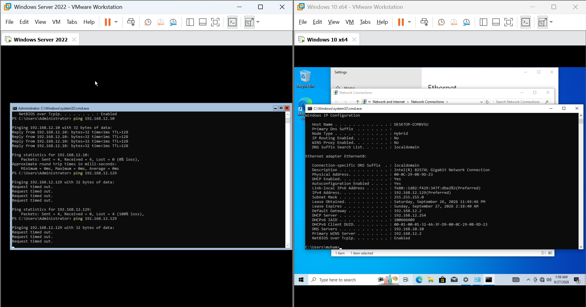

# 01 — Instalasi Domain Controller

## Tujuan
Membangun Domain Controller pertama dari nol: install OS, konfigurasi network dasar, install role AD DS, dan promosi jadi DC yang mengelola domain `lab.local`.

## Kenapa Server Core
Server Core dipilih (bukan Desktop Experience) karena dua alasan: attack surface lebih kecil untuk keamanan, dan jauh lebih ringan untuk resource laptop. Ini juga arah yang disarankan Microsoft untuk production environment sejak Windows Server 2012. Konsekuensinya, semua manajemen dilakukan lewat PowerShell dan remote tools dari client, bukan klik-klik langsung di server.

## Langkah

**1. Instalasi OS**
Windows Server 2022 Standard Evaluation, pilih edisi tanpa "(Desktop Experience)" di layar pemilihan edisi.

**2. Konfigurasi dasar lewat SConfig**
- Rename computer jadi `DC01`
- Set IP static dan DNS (lihat masalah subnet di bawah)

**3. Install role AD DS**
```powershell
Install-WindowsFeature AD-Domain-Services -IncludeManagementTools
```
Ini baru menyiapkan komponennya saja, belum menjadikan server ini DC.

**4. Promosi jadi Domain Controller**
```powershell
Install-ADDSForest -DomainName "lab.local" -DomainNetbiosName "LAB" -InstallDns
```
Command ini sekaligus membuat forest baru, domain baru, dan menginstall+mengkonfigurasi DNS Server secara otomatis. Setelah proses ini selesai dan restart, server resmi jadi Domain Controller.

## Validasi
```powershell
Get-ADDomain
dcdiag
```
`dcdiag` menunjukkan semua test (CheckSDRefDom, CrossRefValidation, LocatorCheck, Intersite) passed.



## Masalah yang Ditemui

**IP address DC dan client beda subnet, padahal sama-sama "NAT"**

Gejala: ping antar DC dan client timeout, `nslookup` gagal resolve.

Root cause: IP static DC di-set ke `192.168.10.0/24`, tapi network NAT virtual yang sebenarnya dipakai VMware adalah `192.168.12.0/24` (ketahuan dari default gateway dan DHCP server address di sisi client). Dua VM yang sama-sama "mode NAT" tidak otomatis satu subnet kalau salah satunya diberi IP static di range yang berbeda.

Fix: samakan subnet IP static DC dengan subnet NAT yang sebenarnya aktif (cek dari `ipconfig /all` di client yang IP-nya dapat dari DHCP, itu menunjukkan subnet yang benar).

Pelajaran: sebelum set IP static di DC, cek dulu subnet yang benar-benar dipakai network virtual (lihat dari IP yang didapat otomatis oleh VM lain), jangan asumsi dari dokumentasi/tutorial.


