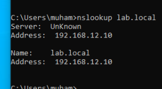
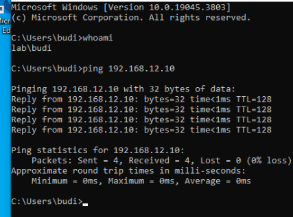
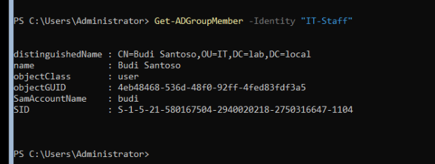

# 02 — DNS, Domain Join, dan Struktur Organisasi

## Tujuan
Menghubungkan client ke domain, lalu membangun struktur organisasi (OU, user, group) yang mencerminkan pembagian divisi sederhana: IT, Finance, HR.

## Kenapa DNS penting untuk AD
DNS bukan sekadar translator nama-ke-IP di sini. AD menyimpan SRV record khusus di DNS yang isinya lokasi Domain Controller untuk domain tertentu. Saat client mencoba join domain atau login, dia bertanya ke DNS "DC untuk domain ini ada di mana", baru setelah itu connect ke DC yang dimaksud. Ini sebabnya DNS client harus diarahkan ke IP DC, bukan ke DNS publik seperti 8.8.8.8 — DNS publik tidak punya SRV record itu.

## Domain Join

Syarat yang sering terlewat: **Windows edition harus Pro/Enterprise/Education**. Windows Home tidak punya kemampuan join domain sama sekali di level sistem, terlepas dari status aktivasi. Opsi "Domain" di System Properties akan tetap abu-abu di edisi Home.

Langkah: Settings → System → About → Domain or workgroup → Change → pilih Domain → masukkan nama domain → autentikasi dengan akun Domain Admin.

Validasi:
```cmd
whoami
echo %USERDOMAIN%
```





## Struktur Organisasi

```powershell
New-ADOrganizationalUnit -Name "IT" -Path "DC=lab,DC=local"
New-ADOrganizationalUnit -Name "Finance" -Path "DC=lab,DC=local"
New-ADOrganizationalUnit -Name "HR" -Path "DC=lab,DC=local"

New-ADUser -Name "Budi Santoso" -SamAccountName "budi" -Path "OU=IT,DC=lab,DC=local" -AccountPassword (ConvertTo-SecureString "Passw0rd123!" -AsPlainText -Force) -Enabled $true
# ... diulang untuk siti (Finance), andiw (HR)

New-ADGroup -Name "IT-Staff" -GroupScope Global -GroupCategory Security -Path "OU=IT,DC=lab,DC=local"
# ... diulang untuk Finance-Staff, HR-Staff

Add-ADGroupMember -Identity "IT-Staff" -Members "budi"
```

User `rina` sengaja ditempatkan di OU Finance tapi **tidak** dimasukkan ke group `Finance-Staff`, untuk jadi kontrol pembanding saat testing security filtering nanti — supaya jelas mana yang menentukan GPO berlaku: keberadaan di OU, atau keanggotaan di group.

## Konsep Penting: Identitas Menempel ke User, Bukan ke PC

Satu hal yang perlu dipahami sebelum lanjut ke GPO: hak akses dan kebijakan itu mengikuti **user**, bukan **komputer**. User yang sama login di PC manapun yang domain-joined akan mendapat profile, permission, dan drive mapping yang sama, ditentukan dari grup dan OU tempat dia berada di AD, bukan dari PC fisik yang dipakai.

## Validasi

```powershell
Get-ADUser -Filter * | Select Name, SamAccountName
Get-ADGroupMember -Identity "IT-Staff"
```


