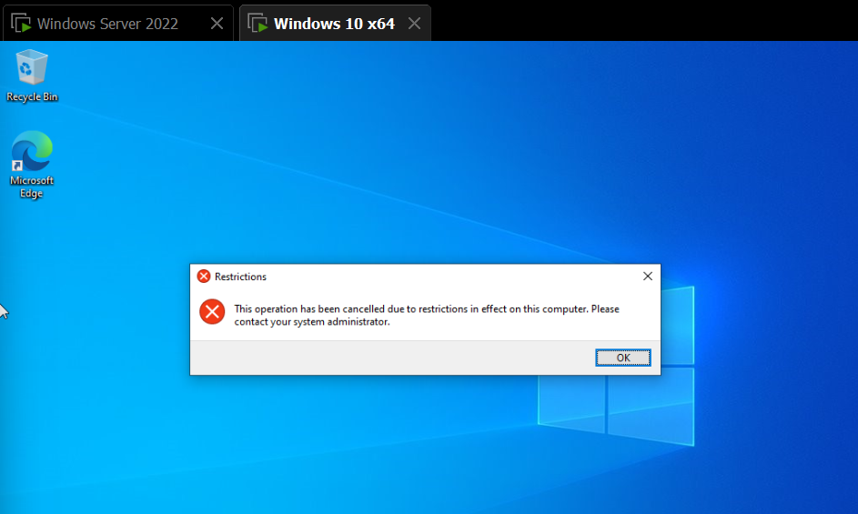
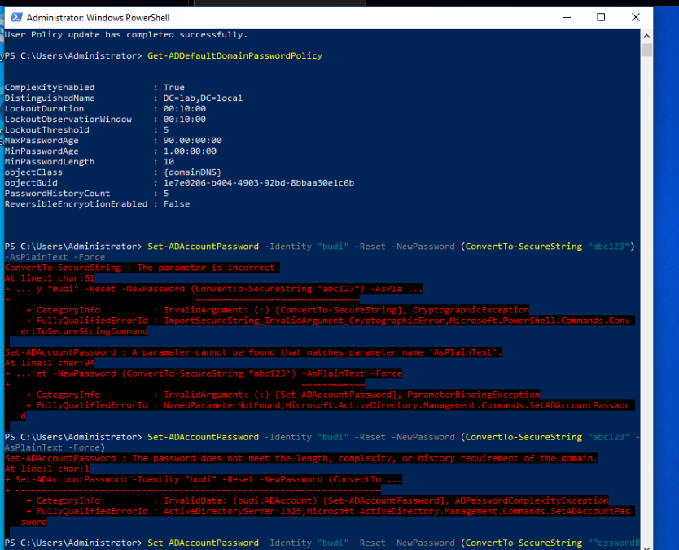

# 03 — Group Policy: Konsep dan Implementasi Dasar

## Tujuan
Memahami cara kerja GPO (Group Policy Object) dan mengimplementasikan dua kebijakan dasar: pembatasan akses Control Panel untuk satu divisi, dan password policy di level domain.

## Konsep: GPO itu Aturan yang Harus Di-link

GPO adalah kumpulan aturan yang berdiri sendiri dan baru berlaku kalau **di-link** ke Domain atau OU tertentu. Satu GPO bisa di-link ke banyak tempat, satu OU bisa punya banyak GPO. Unlink GPO menghentikan penerapan aturan tanpa menghapus GPO itu sendiri.

## Konsep: Hierarki dan Prioritas (LSDOU)

GPO diproses berurutan: **L**ocal → **S**ite → **D**omain → **OU**. Yang diproses belakangan (OU) menang kalau ada konflik dengan yang di level lebih atas (Domain). Semakin spesifik/dekat ke target, semakin tinggi prioritasnya.

OU juga bisa bersarang (OU di dalam OU). GPO yang di-link ke OU induk otomatis ikut (inherit) ke sub-OU di dalamnya, kecuali diblokir eksplisit.

## Konsep: User Configuration vs Computer Configuration

| | User Configuration | Computer Configuration |
|---|---|---|
| Nempel ke | Akun user | Akun komputer |
| Ditentukan dari | OU tempat user berada | OU tempat computer object berada |
| Berlaku saat | User login | Komputer boot |
| Contoh pemakaian | Blokir Control Panel, drive mapping | Firewall, password policy |

Password dan lockout policy untuk akun domain khusus hanya efektif kalau GPO-nya di-link ke **root domain**, bukan OU — ini pengecualian dari pola umum.

## Implementasi 1: Blokir Control Panel untuk OU Finance

GPO `Finance-BlockControlPanel`, di-link ke OU Finance:
**User Configuration → Policies → Administrative Templates → Control Panel → "Prohibit access to Control Panel and PC settings" → Enabled**

Validasi: login sebagai user di OU Finance (`siti`), Control Panel diblok dengan pesan "This operation has been cancelled due to restrictions in effect on this computer." Login sebagai user di OU lain (`budi`), Control Panel tetap bisa diakses — membuktikan GPO benar-benar scoped ke OU Finance saja.



## Implementasi 2: Password & Lockout Policy

GPO untuk ini **harus** diedit di Default Domain Policy, bukan GPO baru di OU, karena password policy domain cuma dibaca dari level Domain.

**Computer Configuration → Policies → Windows Settings → Security Settings → Account Policies**

| Setting | Nilai |
|---|---|
| Minimum password length | 10 characters |
| Password history | 5 passwords |
| Maximum password age | 90 days |
| Complexity requirements | Enabled |
| Account lockout threshold | 5 invalid attempts |
| Lockout duration | 10 minutes |

Validasi:
```powershell
Get-ADDefaultDomainPasswordPolicy
Set-ADAccountPassword -Identity "budi" -Reset -NewPassword (ConvertTo-SecureString "abc123" -AsPlainText -Force)
# ditolak: "does not meet the length, complexity, or history requirement"
```



Testing lockout dilakukan dengan sengaja salah password 5 kali berturut-turut pada akun non-Administrator, lalu divalidasi dan dibuka kembali:
```powershell
Get-ADUser -Identity "siti" -Properties LockedOut | Select Name, LockedOut
Unlock-ADAccount -Identity "siti"
```
