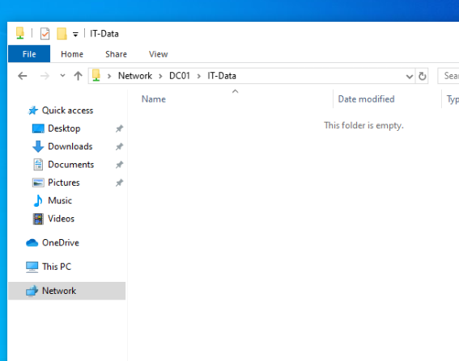
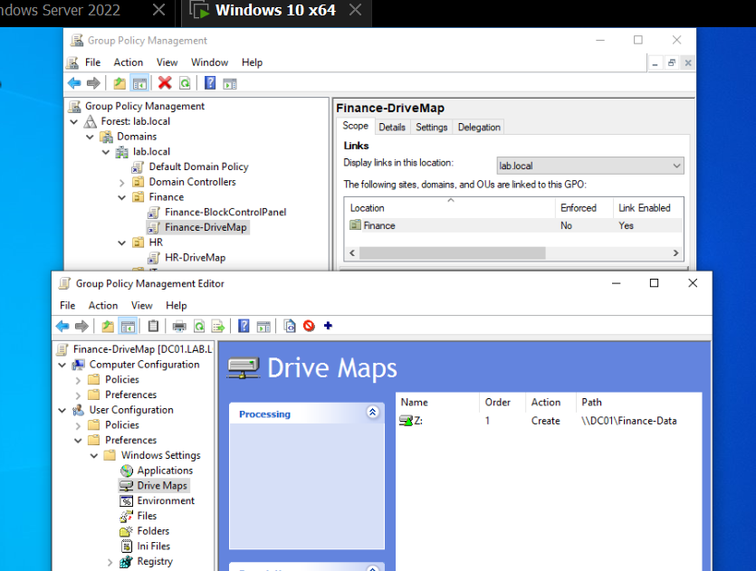
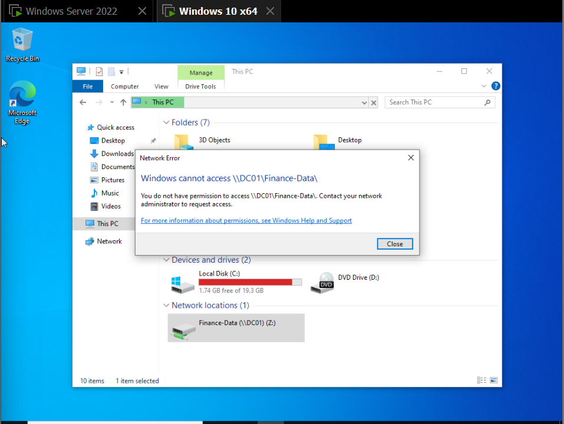
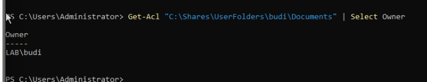
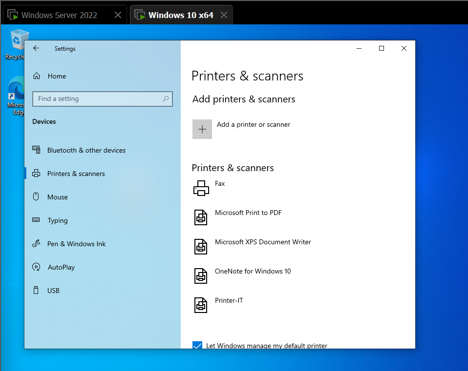

# 04 — File Sharing, Drive Mapping, Folder Redirection, Printer Deployment

## Tujuan
Membangun skenario yang paling umum dipakai di kantor: tiap divisi punya folder sendiri dengan akses terbatas, drive muncul otomatis saat login, data user disimpan di server (bukan di PC lokal), dan printer terdistribusi otomatis lewat GPO.

## Konsep: Dua Lapis Permission

- **Share permission** — izin masuk lewat jaringan (gerbang depan)
- **NTFS permission** — izin di folder itu sendiri (pintu ruangan)

Kalau dua-duanya beda, yang paling ketat yang berlaku. Pola yang dipakai di lab ini: share dibuka lebar untuk Authenticated Users, semua pembatasan sesungguhnya diatur lewat NTFS permission berbasis security group.

## Shared Folder per Divisi

```powershell
New-Item -Path "C:\Shares\IT-Data" -ItemType Directory
New-SmbShare -Name "IT-Data" -Path "C:\Shares\IT-Data" -FullAccess "Authenticated Users"
icacls "C:\Shares\IT-Data" /inheritance:r /grant "Administrators:(OI)(CI)F" "SYSTEM:(OI)(CI)F" "LAB\IT-Staff:(OI)(CI)M"
```
Diulang untuk Finance-Data dan HR-Data dengan group masing-masing.

**Testing dua arah** (bukan cuma diasumsikan): user dicoba akses folder divisi sendiri (harus berhasil) dan folder divisi lain (harus ditolak). Ini penting karena kesalahan permission sering tidak terlihat sampai benar-benar dicoba — command yang jalan tanpa error tidak menjamin hasilnya benar.



## Drive Mapping Otomatis

GPO `IT-DriveMap` (dan setara untuk Finance, HR), di-link per OU:

**User Configuration → Preferences → Windows Settings → Drive Maps → New → Mapped Drive**
- Location: `\\DC01\IT-Data`
- Use: `Z:`
- Action: Replace (bukan Create — Create tidak menimpa drive letter yang sudah terpakai dari GPO lain, yang sempat menyebabkan drive HR tidak ter-update karena masih "nempel" ke mapping Finance sebelumnya)

Penting dipahami: **GPO drive map cuma membuat shortcut, bukan memberi akses**. Akses ditentukan sepenuhnya oleh NTFS permission folder tersebut. Ini dibuktikan saat user HR sengaja diberi drive map ke Finance-Data — drive-nya muncul, tapi begitu dibuka muncul "You do not have permission to access".





## Folder Redirection

Memindahkan lokasi fisik folder Documents dan Desktop user dari PC lokal ke server, supaya data tidak hilang kalau PC rusak dan tetap bisa diakses dari PC domain manapun.

Share khusus dibuat dengan permission supaya tiap user hanya bisa membuat dan mengakses foldernya sendiri:
```powershell
New-SmbShare -Name "UserFolders" -Path "C:\Shares\UserFolders" -FullAccess "Authenticated Users"
icacls "C:\Shares\UserFolders" /inheritance:r /grant "Administrators:(OI)(CI)F" "SYSTEM:(OI)(CI)F" "Authenticated Users:(CI)(S,RD,AD,X,RA)"
```

GPO: **User Configuration → Policies → Windows Settings → Folder Redirection → Documents (dan Desktop)**, setting Basic, target "Create a folder for each user under the root path", root path `\\DC01\UserFolders`.

Validasi: file yang dibuat user di Documents-nya di client benar-benar muncul secara fisik di server:
```powershell
Get-Acl "C:\Shares\UserFolders\budi\Documents" | Select Owner
# Owner: LAB\budi
```
Folder user otomatis terkunci sedemikian rupa sehingga Administrator pun ditolak akses langsung — ini perilaku normal, bukan bug, karena folder redirection memang didesain privat per user.



## Printer Deployment

Printer di-share dari satu titik, lalu didistribusikan ke semua client target lewat GPO, tanpa instalasi manual satu-satu.

**User Configuration → Preferences → Control Panel Settings → Printers → New → Shared Printer**
- Share path: `\\CLIENT01\Printer-IT` (di lab ini disimulasikan tanpa print server terpisah dan tanpa printer fisik — di environment production idealnya printer di-share dari print server dedicated)
- Action: Update

Validasi: printer otomatis muncul di daftar printer user target tanpa instalasi manual.



## Security Filtering

Secara default GPO yang di-link ke OU berlaku untuk semua isi OU itu. Security Filtering mempersempitnya ke security group tertentu saja.

Langkah: tab Scope pada GPO → Security Filtering → hapus `Authenticated Users` → tambahkan group target (misal `Finance-Staff`).

**Jebakan yang ditemukan:** begitu `Authenticated Users` dihapus dari Security Filtering, GPO juga kehilangan izin **baca** oleh komputer client — kecuali ditambahkan ulang secara eksplisit lewat tab **Delegation**, beri permission **Read** untuk `Authenticated Users`. Tanpa langkah ini, GPO terlihat valid di GPMC tapi tidak pernah diterapkan ke siapapun, termasuk ke group yang sudah ditarget.

Validasi dilakukan dengan dua user: satu anggota group target (`siti`, kena restriction), satu di OU yang sama tapi bukan anggota group (`rina`, tidak kena restriction) — membuktikan yang menentukan adalah keanggotaan group, bukan keberadaan di OU.
