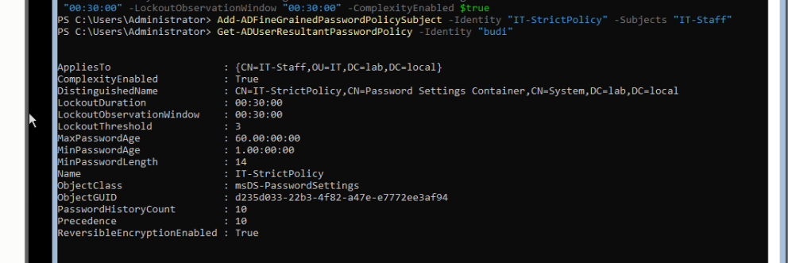
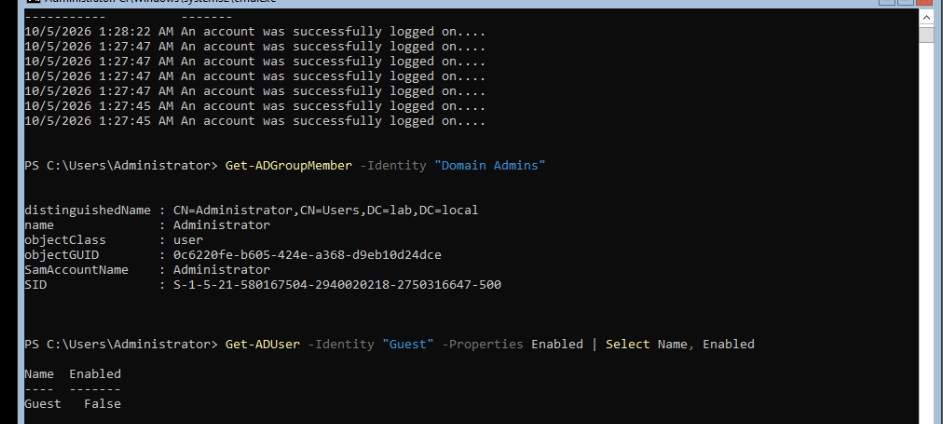
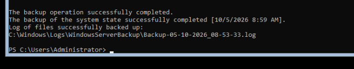

# 05 — Security Hardening & Maintenance

## Tujuan
Memperkuat keamanan baseline domain dan memastikan ada mekanisme untuk mengecek kesehatan DC serta recovery dasar kalau terjadi masalah.

## Fine-Grained Password Policy

Password policy default yang diatur di Default Domain Policy berlaku sama untuk seluruh domain, tidak bisa dibedakan per divisi. Fine-Grained Password Policy (FGPP) mengatasi ini dengan membuat kebijakan tambahan yang ditarget ke security group tertentu.

Diterapkan: `IT-Staff` mendapat kebijakan password lebih ketat (minimum 14 karakter, lockout threshold lebih rendah) dibanding default domain.

```powershell
New-ADFineGrainedPasswordPolicy -Name "IT-StrictPolicy" -Precedence 10 -MinPasswordLength 14 -PasswordHistoryCount 10 -MaxPasswordAge "60.00:00:00" -MinPasswordAge "1.00:00:00" -LockoutThreshold 3 -LockoutDuration "00:30:00" -LockoutObservationWindow "00:30:00" -ComplexityEnabled $true

Add-ADFineGrainedPasswordPolicySubject -Identity "IT-StrictPolicy" -Subjects "IT-Staff"
```

Validasi:
```powershell
Get-ADUserResultantPasswordPolicy -Identity "budi"
```
Hasilnya menunjukkan `budi` (anggota IT-Staff) dikenai `IT-StrictPolicy`, bukan Default Domain Policy, dengan `MinPasswordLength: 14` sesuai yang diset — bukti FGPP override kebijakan domain untuk group yang ditarget.



## Baseline Hardening Lain

**Nonaktifkan akun Guest:**
```powershell
Disable-ADAccount -Identity "Guest"
```

**Audit keanggotaan Domain Admins** (prinsip least privilege — pastikan tidak ada user biasa yang tidak sengaja punya privilege admin domain):
```powershell
Get-ADGroupMember -Identity "Domain Admins"
```

**Review security audit log:**
```powershell
Get-WinEvent -LogName Security -MaxEvents 20 | Where-Object {$_.Id -eq 4624} | Select TimeCreated, Message
```



## Maintenance & Troubleshooting

**`dcdiag`** — diagnostic kesehatan Domain Controller secara menyeluruh (replikasi, DNS, services terkait AD). Semua test di lab ini passed: CheckSDRefDom, CrossRefValidation, LocatorCheck, Intersite.

**`repadmin /replsummary`** — mengecek status replikasi antar Domain Controller. Di lab dengan 1 DC hasilnya kosong (memang tidak ada yang direplikasi), tapi command ini jadi tools utama untuk memastikan kesehatan replikasi di environment multi-DC.

## Backup System State

```powershell
Install-WindowsFeature Windows-Server-Backup
wbadmin start systemstatebackup -backuptarget:E: -quiet
```

**Masalah yang ditemukan:** percobaan pertama backup ke `C:\Backup` gagal dengan error "The specified backup location could not be found or is not a supported backup storage location." Penyebabnya, `wbadmin` tidak mengizinkan backup target berada di drive yang sama dengan yang sedang di-backup (system state mencakup isi drive C:). Solusinya menambah virtual disk kedua, diinisialisasi dan diformat sebagai drive terpisah (`E:`), baru dipakai sebagai backup target.

Hasil: backup berhasil, log tersimpan di `C:\Windows\Logs\WindowsServerBackup\`.


